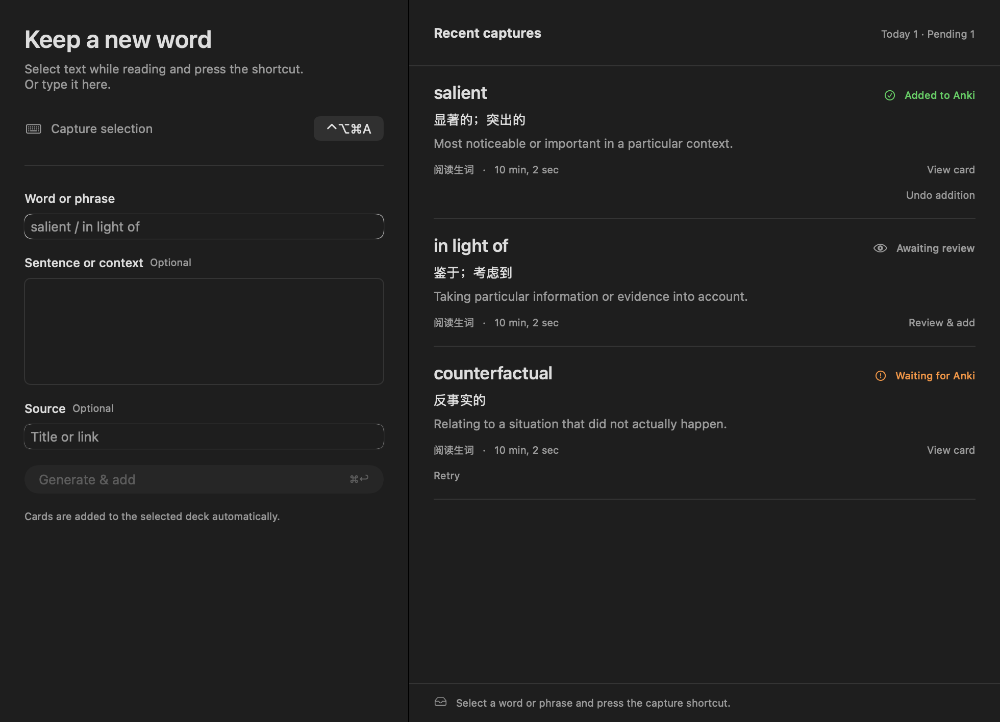

# Anki Capture

**Keep reading. Turn a selection into an Anki card.**

A native Mac app powered by your own **Codex · Claude Code · Gemini CLI**.

[English](README.md) · [简体中文](README.zh-CN.md)

[Download preview](https://github.com/nohairblingbling/anki-capture/releases) · [Feedback](https://github.com/nohairblingbling/anki-capture/issues)

Select a word or phrase while reading a paper, web page, or document, then press **⌃⌥⌘A**. Anki Capture uses your chosen AI to generate a card and add it to your selected Anki deck. You can also enter text manually.

## What it does

- **Capture without leaving your reading flow.** A configurable global shortcut, menu bar access, and an optional Dock icon.
- **Create useful cards with AI.** Generate meanings, definitions, pronunciation, and examples for words, phrases, and short concepts.
- **Use your own AI account.** Connect Codex, Claude Code, or Gemini independently and choose a model through the official CLI installed on your Mac.
- **Learn across languages.** Automatically detect the term’s language. Choose English, Chinese, or Japanese explanations independently of the interface language, with optional study-language and learning-level preferences.
- **Review uncertain results.** Ambiguous languages or meanings wait for your confirmation. Preview and edit cards before adding them, or enable automatic adding for clear results.
- **Keep captures available.** A local queue preserves generated cards when Anki is offline, reuses them on retry, and checks for duplicates. Open saved cards in Anki or undo newly added cards that have no review history.

The interface supports **English, Simplified Chinese, and Japanese**, follows system light/dark appearance, and includes a companion CLI.

For Apple Silicon Macs running macOS 14+. Requires Anki Desktop with AnkiConnect and at least one supported AI CLI. The download is a development preview and is not Apple-notarized.

[MIT License](LICENSE). An independent project.
