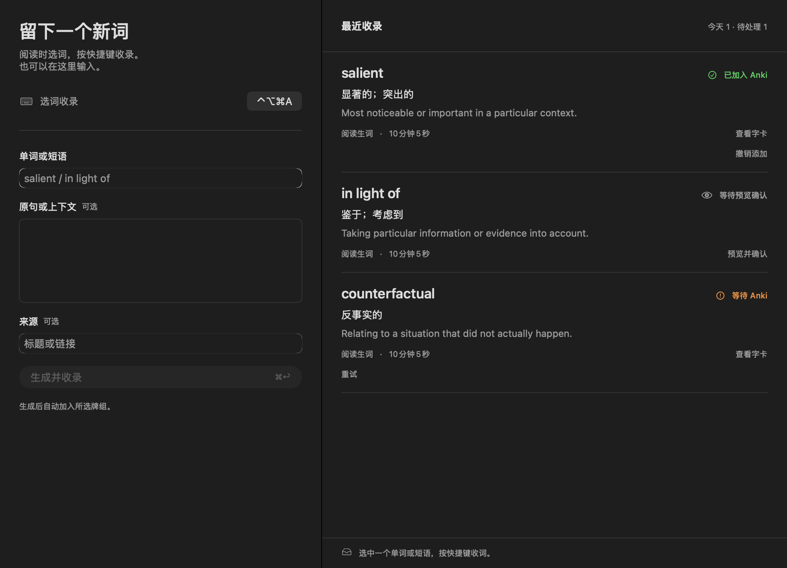

# Anki Capture

**继续阅读，把遇到的词留进 Anki。**

原生 Mac 应用，直接调用你自己的 **Codex · Claude Code · Gemini CLI**。

[English](README.md) · [简体中文](README.zh-CN.md)

[下载 Mac 安装包](https://github.com/nohairblingbling/anki-capture/releases/download/v0.5.2/AnkiCapture-0.5.2-macOS-universal.dmg) · [所有版本](https://github.com/nohairblingbling/anki-capture/releases) · [反馈问题](https://github.com/nohairblingbling/anki-capture/issues)

在论文、网页或文档中选中一个单词或短语，按 **⌃⌥⌘A**，Anki Capture 就会调用所选 AI 生成字卡，加入你预先选好的 Anki 牌组。也可以直接手动输入。

## 主要功能

- **少打断阅读。** 自定义全局快捷键，常驻菜单栏，Dock 图标可以显示或隐藏。
- **AI 辅助制卡。** 为单词、短语或简短概念生成释义、定义、发音和例句。
- **选择或新建牌组。** 在偏好设置中直接创建牌组或子牌组，并设为收录目标。
- **沿用自己的 AI 账号。** Codex、Claude Code、Gemini 独立连接，模型可选，直接使用本机安装的官方 CLI。
- **跨语言学习。** 自动识别词条语言；中、英、日文释义独立于界面语言保存，可选常学语言和熟悉程度。
- **有歧义时先确认。** 语言或词义不确定时等待预览，支持编辑后再加入；识别明确的结果可自动收录。
- **保留收录内容。** 本地队列在 Anki 离线时保留生成结果，重试复用已有字卡并检查重复；支持在 Anki 中打开，以及撤销新建且尚未复习的卡片。

界面支持 **英文、简体中文和日文**，跟随系统明暗，同时提供配套 CLI。

下载 DMG，将 **Anki Capture** 拖到 **Applications（应用程序）** 后打开，无需 Xcode 或编译工具。[发行页](https://github.com/nohairblingbling/anki-capture/releases/tag/v0.5.2)另提供 ZIP 和 SHA-256 校验文件。

需要 macOS 14+、Anki 桌面版、AnkiConnect（插件代码 **2055492159**），以及至少一种支持的 AI CLI。通用构建包含 Apple Silicon 和 Intel 可执行文件；Apple Silicon 已验证，Intel 尚未经真机验证。

当前为开发预览版，**尚未经过 Apple 公证**。如果首次启动被 macOS 阻止，请确认信任此发行来源，再前往 **系统设置 → 隐私与安全性 → 仍要打开**，参见 [Apple 官方说明](https://support.apple.com/zh-cn/102445)。按提示授予辅助功能权限后即可使用选区收录。

[MIT 许可证](LICENSE)。本项目独立开发。
